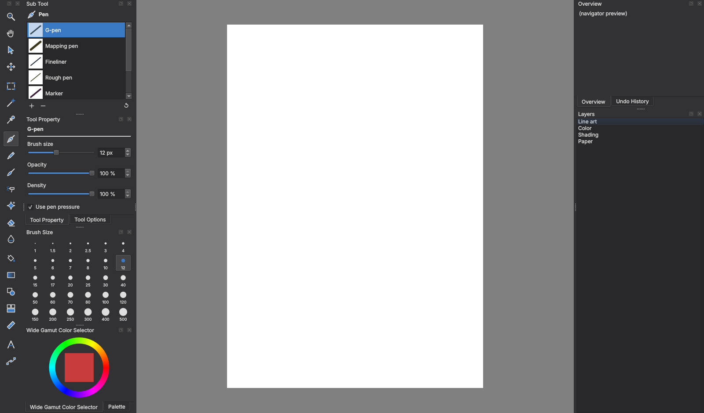

# Krita2CSP: a Clip Studio Paint style interface for Krita 6

Krita2CSP makes Krita look and work more like Clip Studio Paint (CSP), to make
switching from CSP on Windows to Krita on Linux as smooth as possible.

It does **not** turn Krita into CSP. Brushes still paint with Krita's brush
engines, and some CSP features have no Krita equivalent (see
[Differences](#differences-from-clip-studio-paint)).

> **Status: v0.1, first version.** Tested outside Krita against a mock of
> Krita's Python API (see `dev/`), not yet inside a real Krita 6. Please
> report what looks or behaves wrong.



*Preview rendered outside Krita. The Tool, Sub Tool, Tool Property and Brush
Size panels are the real plugin; Krita's own panels (color wheel, layers,
navigator) are placeholders here.*

## What you get

**Layout** like CSP's Studio mode:

```
+------+-----------------+--------------------------+--------------+
| Tool | Sub Tool        |                          | Navigator    |
|      +-----------------+                          | (+ History)  |
|      | Tool Property   |         canvas           +--------------+
|      | (+ Tool Options)|                          | Layers       |
|      +-----------------+                          |              |
|      | Brush Size      |                          |              |
|      +-----------------+                          |              |
|      | Color wheel     |                          |              |
|      | (+ Palette)     |                          |              |
+------+-----------------+--------------------------+--------------+
```

**Tool palette** in CSP order, with our own icons:

| CSP tool | In Krita |
|---|---|
| Zoom, Hand | Zoom tool, Pan tool |
| Operation | Select shapes, Edit shapes (vector) |
| Move layer | Move, Transform, Crop |
| Selection area | Rectangle, Ellipse, Lasso, Polyline, Bezier, Magnetic |
| Auto select | Contiguous selection, Similar color selection |
| Eyedropper | Color sampler |
| Pen, Pencil, Brush, Airbrush, Decoration, Eraser, Blend | Groups of Krita brush presets (e.g. Pen > G-pen = Krita's *Ink-3 Gpen*) |
| Fill, Gradient | Fill, Enclose and fill, Colorize mask, Smart patch; Gradient |
| Figure | Line, Rectangle, Ellipse, Polygon, Polyline, Bezier, Freehand path |
| Frame border | Krita's knife tool for cutting comic panels on vector layers; Rectangle |
| Ruler | Assistants (perspective and more), Symmetry, Measure |
| Text | Text tool |
| Correct line | Edit shapes, Calligraphy |

**Sub Tool**: the brushes or tools of the selected entry, like CSP. The `+`
button adds the brush you are using to the current group, `-` removes one,
and the arrow restores the defaults. Like CSP, each entry remembers the last
sub tool you used.

**Tool Property**: brush size, opacity, density and pen pressure. Krita's own
*Tool Options* (stabilizer, fill and selection settings) are in the tab next
to it.

**Brush Size**: one click size presets, like CSP's Brush Size palette.

**Shortcuts**: Krita's built-in *Clip Studio Paint compatible* shortcut
scheme, plus these tool keys from the plugin:

| Key | Tool | Press again |
|---|---|---|
| P | Pen | Pencil |
| B | Brush | Airbrush, then Decoration |
| E | Eraser | |
| J | Blend | |

Other keys from Krita's CSP scheme include G (gradient), M (lasso
selection), W (auto select), I (eyedropper), K (move), O (operation),
T (text), H (hand), Ctrl+T (transform). Krita's eraser mode toggle moves from
E to C.

**Themes**: *Krita2CSP Dark* and *Krita2CSP Light*, neutral gray themes in
the spirit of CSP's color schemes.

**Language**: the panels switch to German when Krita runs in German.

## Requirements

- Linux with Krita 6 (checked against Krita 6.0.4.1; the CSP shortcut scheme
  is included in that version).
- `python3` for the installer (preinstalled on nearly every distribution).

## Install

1. Close Krita.
2. Download this repository (green *Code* button > *Download ZIP*, then
   unpack) or `git clone` it.
3. In a terminal in the unpacked folder:

   ```bash
   ./install.sh          # dark theme
   ./install.sh --light  # light theme
   ```

   For the Flatpak version of Krita, add `--flatpak`. `./install.sh --help`
   lists all options.
4. Start Krita. The CSP layout appears a moment after the window opens.

The installer backs up `kritarc` and `kritashortcutsrc` before changing them
(files ending in `.krita2csp-backup-<date>` next to the originals).

If the layout gets mixed up later: **Tools > Scripts > Apply CSP layout**.

## Pen display

Setup notes for the XP-Pen Artist 15.6 Pro V2, including how to match CSP's
pen feel, are in [docs/TABLET.md](docs/TABLET.md).

## Before leaving Windows: export your CSP files

Krita cannot open `.clip` files. While CSP is still installed, save a copy of
every artwork you want to keep editing as a Photoshop document (**.psd**)
with layers, from CSP's File menu. A single-layer export (PNG, JPEG) loses the
layers. Krita opens PSD files with their layers. Things that only exist in
CSP (some layer properties, vector layers, 3D) are flattened or lost, so keep
the original `.clip` files as well.

## Differences from Clip Studio Paint

- **Brushes**: Krita's brush engines behave differently. The presets in the
  groups are Krita's closest matches, not CSP brushes. CSP brushes (`.sut`)
  cannot be imported.
- **Vector layers**: Krita's vector layers are SVG shapes. CSP's vector
  eraser (erasing up to intersections) does not exist in Krita.
- **No equivalent**: Smart Shape, materials and Clip Studio Assets, 3D
  models, `.clip` files, CSP's cloud.
- **Tool Property**: shows the settings Krita exposes to plugins (size,
  opacity, density, pressure). Stabilizer and other tool settings are in the
  Tool Options tab.

## Uninstall

```bash
./uninstall.sh            # or: ./uninstall.sh --flatpak
```

Then in Krita: **Window > Workspace > Default** for Krita's standard layout.

## Development

`dev/preview.py` runs the panels outside Krita against a small mock of
Krita's API and saves a screenshot:

```bash
pip install PyQt6
QT_QPA_PLATFORM=offscreen python3 dev/preview.py dark preview.png
```

## License and trademarks

GPL-3.0-or-later, like Krita itself. See [LICENSE](LICENSE).

Not affiliated with Celsys or the Krita Foundation. Clip Studio Paint is a
trademark of Celsys, Inc. All icons are original drawings made for this
project.
